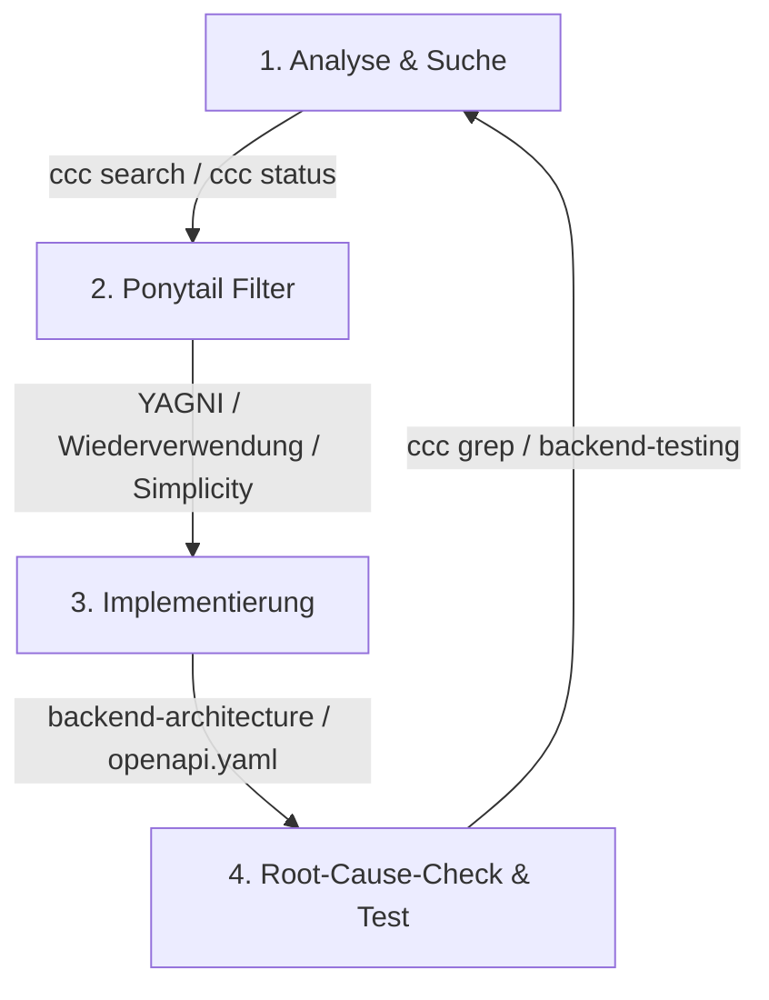

# 🌊 OceanGuard Coding & Agent Guidelines (`.agents/AGENTS.md`)

This file defines the core behavioral rules, coding principles, and setup requirements that must be followed by AI agents and developers working on the OceanGuard codebase.

---

## 1. Core Development Principles

### 1.1 Think Before Coding
*   **Target Issues**: Wrong assumptions, hidden confusion, missing tradeoffs.
*   **Rule**: Don't assume. Don't hide confusion. Surface tradeoffs.
    *   State assumptions explicitly — If uncertain, ask rather than guess.
    *   Present multiple interpretations — Don't pick silently when ambiguity exists.
    *   Push back when warranted — If a simpler approach exists, say so.
    *   Stop when confused — Name what's unclear and ask for clarification.

### 1.2 Simplicity First
*   **Target Issues**: Overcomplication, bloated abstractions.
*   **Rule**: Write the minimum code that solves the problem. Nothing speculative.
    *   No features beyond what was asked.
    *   No abstractions for single-use code.
    *   No "flexibility" or "configurability" that wasn't requested.
    *   No error handling for impossible scenarios.
    *   If 200 lines could be 50, rewrite/refactor it to be simpler.
    *   *The test*: Would a senior engineer say this is overcomplicated? If yes, simplify.

### 1.3 Surgical Changes
*   **Target Issues**: Orthogonal edits, touching code you shouldn't.
*   **Rule**: Touch only what you must. Clean up only your own mess.
    *   Don't "improve" adjacent code, comments, or formatting.
    *   Don't refactor things that aren't broken.
    *   Match existing style, even if you'd do it differently.
    *   If you notice unrelated dead code, mention it — don't delete it.
    *   Remove imports/variables/functions that *your* changes made unused.
    *   Don't remove pre-existing dead code unless asked.
    *   *The test*: Every changed line should trace directly to the user's request.

### 1.4 Goal-Driven Execution
*   **Target Issues**: Leverage through tests-first, verifiable success criteria.
*   **Rule**: Define success criteria. Loop until verified.
    *   Transform imperative tasks into verifiable goals:
        *   Instead of "Add validation" → "Write tests for invalid inputs, then make them pass".
        *   Instead of "Fix the bug" → "Write a test that reproduces it, then make it pass".
        *   Instead of "Refactor X" → "Ensure tests pass before and after".
    *   For multi-step tasks, state a brief plan:
        1. [Step] → verify: [check]
        2. [Step] → verify: [check]
        3. [Step] → verify: [check]
    *   *The test*: Strong success criteria let the agent loop independently. Weak criteria ("make it work") require constant clarification.


## 2. 🛠️ Team Setup & AI Agent Tools (Requirements)

To optimize work with agentic AI assistants (like Claude, Grok, or Gemini), this project utilizes two helper modules. These must be set up locally and added to the local Git exclusion file to avoid cluttering the repository.

### Prerequisites & Installation

1. **Ponytail (Lazy Senior Dev Mode):**
   Clone the repository into your local project root (`oceanguard/`):
   ```bash
   git clone https://github.com/DietrichGebert/ponytail.git
   ```

2. **CocoIndex-Code (AST-based Semantic Search):**
   Install the tool globally or in your environment:
   * Using `uv`:
     ```bash
     uv tool install --upgrade 'cocoindex-code[full]'
     ```
   * Using `pipx`:
     ```bash
     pipx install 'cocoindex-code[full]'
     ```
   Then, clone the repository locally inside your project root to provide local skills and reference for agents:
   ```bash
   git clone https://github.com/cocoindex-io/cocoindex-code.git
   ```

3. **Configure Git Exclude:**
   Do **not** commit the external tools (`ponytail/`, `cocoindex-code/`) to the repository. Instead, add them to your local git exclude file `.git/info/exclude` under your repository folder:
   ```text
   ponytail/
   cocoindex-code/
   ```
   *Note: `.agents/` (including `AGENTS.md` and the local skills) is tracked in Git for submission, so it is not excluded.*

4. **IDE Workspace Linking (Optional):**
   If you open the parent directory in your IDE (e.g. one level above the git repo), create a symbolic link so the IDE can discover the customizations root:
   ```bash
   ln -s oceanguard/.agents .agents
   ```

### 2.2 External AI Agent Plugins & Skills (GitHub Repositories)

For reference, the external helper tools and plugins used by the agent in this workspace are hosted on GitHub:
*   **Ponytail (Lazy Senior Dev Mode):** [DietrichGebert/ponytail](https://github.com/DietrichGebert/ponytail)
*   **CocoIndex-Code (Semantic Search CLI):** [cocoindex-io/cocoindex-code](https://github.com/cocoindex-io/cocoindex-code)

---

## 3. 📂 Modularisierte Entwicklungs-Skills im Projekt

Für konkrete Implementierungen und detaillierte Leitfäden MUSS der Agent bei Bedarf die folgenden spezialisierten Skills aus dem Ordner [skills/](file://./skills) einlesen und anwenden:

1. **`backend-architecture` (Skill):**
   * *Inhalt:* Konkrete Code-Templates für Router (`app/routers/`), Schemata (`app/schemas/`), Services (`app/services/`) und Sicherheits-/Soft-Delete-Regeln basierend auf der [openapi.yaml](file://../documentation/openapi.yaml).
   * *Verwendung:* Immer beim Erstellen oder Modifizieren von Endpunkten, Datenbankabfragen oder Schemata im Backend.
2. **`backend-testing` (Skill):**
   * *Inhalt:* Richtlinien für Unit- und Integrationstests, Mocks für Webservices (z. B. Open-Meteo, AISstream) und Beispieltestfälle.
   * *Verwendung:* Immer beim Schreiben oder Ändern von Test-Suiten unter `app/tests/`.
3. **`cocoindex-workflow` (Skill):**
   * *Inhalt:* Praktische CLI-Befehlsreferenz für die semantische und strukturelle Suche (`ccc search`, `ccc grep`) und das Zusammenspiel mit den Ponytail-Prinzipien.
   * *Verwendung:* Bei der Einarbeitung in Code-Teile und der Suche nach vorhandenen Implementierungen vor dem Codieren.

---

## 4. 🔄 Integrierter Entwicklungs-Workflow (Zusammenspiel)

Bei jeder Feature-Entwicklung oder Fehlerbehebung arbeiten die Prinzipien und Skills in folgendem Kreislauf zusammen:



### Die Phasen im Detail:

1. **Phase 1: Analyse & Suche (CocoIndex-Workflow)**
   * **Ziel:** Lokalisieren, wo das Thema in der Codebase lebt, und Verstehen des Kontexts.
   * **Aktion:** Nutze `ccc search` (semantische Suche), um Dateien und existierende Logik zu finden.
2. **Phase 2: Ponytail-Filter anwenden (AGENTS.md - Core Principles)**
   * **Ziel:** Überengineering verhindern und Diffs minimal halten.
   * **Aktion:** Entscheide: Brauchen wir das wirklich? Gibt es einen ähnlichen Helper, den wir wiederverwenden können? Kann die Änderung kleiner ausfallen?
3. **Phase 3: Echte Implementierung (Backend-Architecture)**
   * **Ziel:** Saubere Trennung von Routers, Services und Schemata gemäß OpenAPI-Spezifikation.
   * **Aktion:** Lade den `backend-architecture` Skill und wende die dort definierten Muster für Pydantic-Schemata und FastAPI-Definitionen an.
4. **Phase 4: Root-Cause-Check & Test (Backend-Testing & CocoIndex-Grep)**
   * **Ziel:** Fehlerfreiheit und Vermeidung von Regressionen bei anderen Aufrufern.
   * **Aktion:** Finde mit `ccc grep` alle betroffenen Stellen/Aufrufer im gesamten Projekt und passe sie chirurgisch an. Schreibe danach Unit-/Integrationstests gemäß `backend-testing` Skill und führe sie aus.

---

## 5. 🧼 Best Practices: Kontext-Generierung & Duplikats-Vermeidung

Um eine saubere Codebase zu gewährleisten und unnötige Code-Duplikate zu verhindern, müssen Agenten und Entwickler diese Richtlinien zur Kontext-Generierung befolgen:

* **Kein Kontext-Bloat (No Context Bloat):** Kopiere niemals die gesamte Codebase oder ganze Verzeichnisse ungefiltert in den Prompt-Kontext. Das führt zu Verwirrung der KI, hohen Kosten und langsamen Antworten.
* **On-Demand Kontext via CocoIndex:** Verwende gezielte semantische Suche (`ccc search "<konzept>"`) und AST-Grep (`ccc grep '<muster>'`), um ausschließlich die Dateien und Codeblöcke zu laden, die für die aktuelle Aufgabe relevant sind.
* **"Suche vor Codierung" (Search Before Coding):** Vor dem Schreiben neuer Hilfsfunktionen, Validierungsregeln oder mathematischer Formeln muss eine semantische Suche durchgeführt werden, um zu prüfen, ob ähnliche Logiken bereits existieren (z. B. `ccc search "distance calculation"`). Bereits vorhandener Code MUSS wiederverwendet werden.
* **MCP-Schnittstelle nutzen:** Nutze den MCP-Server (`ccc mcp`), damit die KI-Agenten den Code-Index eigenständig und bedarfsgerecht über Vektorsuchen abfragen können, statt manuell nach Dateien suchen zu müssen.
