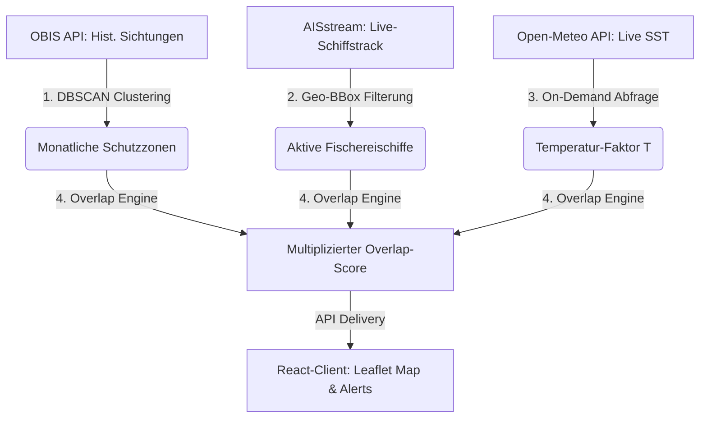

## 1. Problemstellung & Herausforderungen (Detail)

Die weltweiten Ozeane sind durch Überfischung, illegale Fischerei (IUU) und den unbeabsichtigten Beifang in sensiblen Habitaten akut bedroht. Besonders kritisch ist diese Situation für wandernde Fischpopulationen (z. B. pelagische Arten wie der Rote Thunfisch oder Schwertfisch). Während ihrer saisonalen Wanderungen konzentrieren sich die Tiere in spezifischen Korridoren oder Laichgebieten. Werden diese Zonen zeitgleich intensiv durch industrielle Fischereifahrzeuge befischt, kann dies zum Kollaps der gesamten Population führen.

Bisher standen Überwachungsorganisationen, NGOs und staatliche Behörden vor folgenden **Herausforderungen**:
1. **Isolierte Datensilos:** 
   - **AIS (Automatic Identification System):** Liefert kontinuierliche, weltweite Schiffspositionen in Echtzeit. Die Rohdaten enthalten jedoch Millionen Nachrichten pro Tag und müssen aufwendig gefiltert werden, um Fischereifahrzeuge von Frachtern zu trennen und deren Aktivitätsstatus (Transit vs. aktiver Fischfang) zu analysieren.
   - **OBIS (Ocean Biodiversity Information System):** Bietet historische Sichtungsdaten über Jahrzehnte hinweg. Diese Daten sind jedoch statisch, opportunistisch erhoben und weisen erhebliche Ungenauigkeiten auf (z. B. fehlerhafte Sichtungen auf dem Festland).
   - **Marine Wetterdaten (SST - Sea Surface Temperature):** Die Wassertemperatur beeinflusst die tatsächliche Anwesenheit wechselwarmer (ektothermer) Fische maßgeblich. Wetter-APIs bieten diese Daten an, sie sind jedoch nicht mit aktuellen Schiffsbewegungen oder historischen Sichtungsdaten korreliert.
2. **Fehlende Echtzeit-Risikoanalyse:** Es existierte keine Software, die diese drei komplexen Datenströme in Echtzeit miteinander verknüpft, um unmittelbare Bedrohungspotenziale für Schutzgebiete und Migrationskorridore zu berechnen und visuell aufzubereiten.

---

## 2. Unsere Lösung: OceanGuard

OceanGuard löst dieses Problem durch eine integrierte Web-Applikation, die als Brücke zwischen den isolierten Datenquellen fungiert. Das System führt Schiffsbewegungen, historische Artensichtungen und dynamische Meeresbedingungen in einem neuartigen **multiplikativen Overlap-Score** zusammen.

### 🛡️ Nutzen für Zielgruppen:
- **Naturschutzorganisationen (NGOs):** Können in Echtzeit überwachen, ob geschützte Migrationszonen von Fischereifahrzeugen infiltriert werden, um Kampagnen gezielt auszurichten.
- **Fischereibehörden & Küstenwachen:** Erhalten einen priorisierten Feed von Schiffen, die ein hohes Risiko aufweisen (🔴 Kritisch), um Kontrollen auf See effizienter zu planen.
- **Wissenschaftler & Öffentlichkeit:** Gewinnen Einblick in das Zusammenspiel von Wassertemperaturen, saisonalen Fischwanderungen und Fischereiaktivitäten im Mittelmeer und Nordatlantik.

---

## 3. Technischer Lösungsansatz

Der technische Lösungsansatz von OceanGuard basiert auf einer strukturierten vierstufigen Datenverarbeitungs-Pipeline:



### 1. Daten-Vorauswertung & Clustering (OBIS-Service):
Beim Systemstart liest das Backend historische Vorkommensdaten für die konfigurierten Fischarten ein. Über ein **DBSCAN-Dichteverfahren (Density-Based Spatial Clustering)** auf der Erdkugel (Haversine-Metrik) werden Ausreißer gefiltert und geografisch getrennte Hotspots pro Kalendermonat berechnet. Eine integrierte Plausibilitätsprüfung filtert fehlerhafte Land-Koordinaten heraus, indem sie diese mit der Meeresoberflächentemperatur (SST) von Open-Meteo abgleicht (Landpunkte werfen einen 404-Fehler und werden verworfen).

### 2. Echtzeit-Schiffsdatenstrom (AIS-Service):
Das Backend baut eine dauerhafte, ausfallsichere WebSocket-Verbindung zu *AISstream.io* auf. Um die Netzwerklast zu minimieren, abonniert das Backend nur Bounding-Boxes, die den berechneten monatlichen Fisch-Migrationszonen entsprechen. Eingehende Schiffspositionen werden in einem hochperformanten In-Memory-Cache gehalten und gefiltert: Nur als Fischereifahrzeuge klassifizierte Schiffe werden weiterverarbeitet.

### 3. Dynamische Korrelation (Overlap-Engine):
Wird der Overlap-Score angefragt, führt das Backend eine **Tournament-Auswahl** durch. Ein Schiff wird gegen alle monatlichen Zonen der Fischart getestet. Das System fragt stündliche Wassertemperaturen (SST) für die Zonen-Zentren bei Open-Meteo an (gestützt durch einen 24-Stunden-Cache) und berechnet für jede Zone den Score. Das Schiff wird derjenigen Zone zugeordnet, bei der es das höchste Bedrohungspotenzial erzielt. Ein geografischer Tie-Breaker ordnet Schiffe außerhalb aller Zonen der am nächsten liegenden Zone zu.

### 4. RESTful API Delivery & Visualisierung:
Die Ergebnisse werden über eine FastAPI REST-Schnittstelle ausgeliefert. Um die REST-Architektur-Constraints vollständig zu erfüllen, sind die Ressourcen mit relativen HATEOAS-Folgelinks ausgestattet. Statische Anfragen werden über zeit- und ETag-basierte Cache-Header optimiert. Der React-Client stellt die Schutzzonen und Schiffe farbkodiert auf einer Leaflet-Karte dar und listet kritische Vorfälle in einem Echtzeit-Alerts-Feed.

---

## 4. Externe APIs im Detail

### 4.1 OBIS – Ocean Biodiversity Information System

- **Zweck:** Historische Sichtungsdaten von Meerestieren → daraus saisonale Verbreitungszonen ableiten
- **Base-URL:** [https://api.obis.org/v3/](https://api.obis.org/v3/)
- **Wichtigster Endpoint:** GET /occurrence
- **Relevante Parameter:**
    - scientificname – z.B. Thunnus thynnus (Roter Thun)
    - startdate / enddate – Zeitraum filtern
    - geometry – WKT-Polygon für Region
- **Relevante Response-Felder:** `decimalLatitude`, `decimalLongitude`, `eventDate`, `scientificName`
- **Auth:** Keine (komplett offen)
- **Nutzung im Projekt:** Daten werden periodisch abgerufen und vorverarbeitet. Pro Art und Monat wird aus allen historischen Sichtungen der räumliche Mittelpunkt (Durchschnitt aller Lat/Lng-Werte) + ein Radius berechnet. Das ergibt eine **saisonale Verbreitungszone** (Kreis) pro Monat. Nicht Echtzeit.

### 4.2 AISstream.io – Echtzeit-Schiffspositionen

- **Zweck:** Live-Positionen von Schiffen weltweit via AIS-Transponder
- **Verbindung:** WebSocket `wss://stream.aisstream.io/v0/stream`
- **Auth:** Kostenloser API-Key nach Registrierung
- **Relevante Felder:** `Latitude`, `Longitude`, `SpeedOverGround`, `ShipType`
- **Wichtige Logik:** `ShipType = 30` → Fischereifahrzeug. Geschwindigkeit < 5 Knoten → wahrscheinlich aktiv fischend
- **Warum WebSocket statt REST?** Für Echtzeit-Schiffstracking wäre REST-Polling extrem ineffizient (tausende Requests/Minute). WebSocket liefert einen kontinuierlichen Datenstrom – ideal für Live-Positionen.

### 4.3 Open-Meteo Marine Weather API

- **Zweck:** Aktuelle Meeresbedingungen als Kontext-Layer
- **Base-URL:** [https://marine-api.open-meteo.com/v1/marine](https://marine-api.open-meteo.com/v1/marine)
- **Parameter:** `latitude`, `longitude`, `hourly` (z.B. `sea_surface_temperature`, `wave_height`)
- **Auth:** Keine
- **Nutzung im Projekt:** Wassertemperatur bestätigt/widerlegt Migrationswahrscheinlichkeit. Z.B. Roter Thun bevorzugt 15–25°C – wenn die aktuelle Temperatur in diesem Bereich liegt, steigt der Overlap-Score.

---

## 5. Eigener REST Web Service – Der Mehrwert

Unser Backend konsumiert die drei externen APIs und bietet dem Frontend über eine **saubere REST-Schnittstelle** aufbereitete, kombinierte Daten an.

### Kern-Endpoints (Tatsächliche Implementierung):

| Methode | Endpoint | Beschreibung |
|---|---|---|
| `GET` | `/species/` | Liste aller aktiven Fischarten (öffentlich) |
| `GET` | `/species/{species_id}` | Details einer bestimmten Fischart (öffentlich) |
| `GET` | `/species/{species_id}/migration?month=` | Saisonale Verbreitungszone einer Art pro Monat (GeoJSON) (öffentlich) |
| `GET` | `/vessels` | Liste aller getrackten Schiffe (öffentlich) |
| `GET` | `/vessels/{mmsi}` | Einzelnes Schiff abrufen (öffentlich) |
| `GET` | `/vessels/species/{species_id}` | Schiffe in der BBox einer bestimmten Fischart (öffentlich) |
| `GET` | `/vessels/status` | Status der AIS WebSocket-Verbindung (öffentlich) |
| `GET` | `/overlap?species_id=&month=` | **Kern:** Overlap-Score Berechnung für alle Schiffe |
| `GET` | `/overlap/{mmsi}?species_id=` | Overlap-Score Berechnung für ein einzelnes Schiff |
| `GET` | `/alerts?species_id=` | Aktive Warnungen für Schiffe mit Score >= 0.4 (öffentlich) |
| `GET` | `/marine-conditions?lat=&lng=` | Meeresbedingungen an einem Punkt |
| `GET` | `/admin/users` | Liste aller registrierten Benutzer (Admin) |
| `DELETE`| `/admin/users/{user_id}` | Benutzer löschen (Admin, Selbstlöschung 403) |
| `PATCH` | `/admin/users/{user_id}/role` | Benutzerrolle ändern (Admin) |
| `GET` | `/admin/system` | Live System-Status / Telemetrie (Admin) |

### Overlap-Score Algorithmus

$$Score = D \times (A \times 0.6 + T \times 0.4)$$

Wobei:

- **D** = Distanz-Faktor (Wie nah ist das Schiff an der Verbreitungszone?)
- **A** = Aktivitäts-Faktor (Wie wahrscheinlich fischt das Schiff aktiv?)
- **T** = Temperatur-Faktor (Passt die aktuelle Wassertemperatur zum Optimum der Art?)

#### ⚙️ Multi-Zonen & Tournament-Selection Pattern
Da eine Fischart in einem Monat mehrere geografisch getrennte Hotspots (Cluster-Zentren) haben kann (berechnet mittels **DBSCAN** aus OBIS-Sichtungen), wurde der Algorithmus wie folgt erweitert:

1. **Zonen-spezifische Temperatur**: Das Backend lädt für jedes der berechneten Cluster-Zentren die jeweils lokale Meeresoberflächentemperatur (SST) von Open-Meteo herunter.
2. **Schleife über alle Zonen**: Für jedes Schiff wird der Score $Score_i$ für jede einzelne dieser Zonen $i$ separat berechnet.
3. **Tournament-Auswahl (`get_best_evaluation_for_vessel`)**: 
   Das Schiff wird derjenigen Zone zugeordnet, bei der es den **höchsten Bedrohungsscore** erzielt. 
4. **Tie-Breaker für Schiffe außerhalb der Zonen ("Out of Bounds")**:
   Wenn ein Schiff außerhalb des Radius aller Zonen liegt und somit überall einen Score von `0.0` erzielt, wird es über einen geografischen **Tie-Breaker** derjenigen Zone zugeordnet, die am nächsten an seinen aktuellen Koordinaten liegt. Das verhindert Zuordnungsfehler und ordnet auch inaktive Schiffe der korrekten geografischen Zone zu.

#### Warum multiplikativ?

Die Distanz fungiert als **Gatekeeper**. Wenn ein Schiff weit entfernt ist ($D = 0$), ist der gesamte Score 0 – egal wie langsam es fährt oder wie perfekt die Temperatur ist. Das verhindert **False Positives**: Ein Schiff 500 km entfernt kann in einer rein additiven Formel trotzdem einen WARNING-Score erreichen, obwohl es offensichtlich keine Bedrohung darstellt.

Erst wenn das Schiff tatsächlich in der Nähe ist ($D > 0$), verfeinern die Faktoren A und T den Score:
- **A** bestimmt, ob das Schiff aktiv fischt (60% Gewicht innerhalb der Klammer, da direkter messbar und zuverlässiger)
- **T** prüft, ob Fische wahrscheinlich überhaupt da sind (40% Gewicht als Plausibilitätsprüfung)

Alle drei Faktoren nutzen dasselbe einfache Pattern – eine lineare Interpolation zwischen 0.0 und 1.0:

$$Faktor = \max\left(0,\; 1 - \frac{Wert}{Schwelle}\right)$$

---

#### D – Distanz-Faktor

$$D = \max\left(0,\; 1 - \frac{d}{100}\right)$$

$d$ = Entfernung des Schiffs zur nächsten Verbreitungszone in km (berechnet via Haversine-Formel).

| Entfernung $d$ | $D$ | Bedeutung |
|---|---|---|
| 0 km (in der Zone) | 1.0 | Maximale Bedrohung |
| 25 km | 0.75 | Sehr nah |
| 50 km | 0.5 | Mittlere Entfernung |
| 75 km | 0.25 | Ziemlich weit |
| 100+ km | 0.0 | Keine Bedrohung → **gesamter Score wird 0** |

**Datenquellen:** Schiffsposition aus AISstream (`Latitude`, `Longitude`) + Zonenmittelpunkt aus vorverarbeiteten OBIS-Daten.

**Haversine-Formel für die Distanzberechnung:**

$$d = 2r \cdot \arcsin\left(\sqrt{\sin^2\left(\frac{\Delta\phi}{2}\right) + \cos(\phi_1)\cos(\phi_2)\sin^2\left(\frac{\Delta\lambda}{2}\right)}\right)$$

Wobei $r = 6371$ km (Erdradius), $\phi$ = Breitengrad in Radian, $\lambda$ = Längengrad in Radian.

---

#### A – Aktivitäts-Faktor

$$A = \max\left(0,\; 1 - \frac{v}{10}\right)$$

$v$ = Geschwindigkeit des Schiffs in Knoten.

| Geschwindigkeit $v$ | $A$ | Bedeutung |
|---|---|---|
| 0 kn | 1.0 | Steht still, fischt höchstwahrscheinlich |
| 2 kn | 0.8 | Schleppt Netz (typische Schleppgeschwindigkeit) |
| 3 kn | 0.7 | Langsam, wahrscheinlich fischend |
| 5 kn | 0.5 | Möglicherweise fischend |
| 8 kn | 0.2 | Wahrscheinlich Transit |
| 10+ kn | 0.0 | Definitiv Transit, fischt nicht |

**Warum Aktivität statt Kursrichtung?** Die Geschwindigkeit eines Fischereifahrzeugs ist ein wissenschaftlich etablierter Proxy für Fischerei-Aktivität (vgl. Kroodsma et al. 2018, Global Fishing Watch). Ein Schleppnetz erzeugt enormen Widerstand – Schiffe können physikalisch nicht schnell fahren während sie fischen. Eine Migrationsrichtung lässt sich aus OBIS-Sichtungsdaten nicht zuverlässig ableiten, da diese nur Positionen, keine Richtungen enthalten.

**Datenquelle:** `SpeedOverGround` aus AISstream.

---

#### T – Temperatur-Faktor

$$T = \max\left(0,\; 1 - \frac{|T_{aktuell} - T_{mitte}|}{R}\right)$$

- $T_{mitte}$ = Mitte des Optimalbereichs der Art (z.B. Roter Thun: `temp_mid = 22.0°C`)
- $R$ = Bereichs-Divisor (z.B. Roter Thun: `temp_range = 10.0°C`)

**Beispiel Roter Thun** (optimal 15–25°C, $T_{mitte} = 22.0°C$, $R = 10.0°C$):

| Wassertemp. $T_{aktuell}$ | $T$ | Bedeutung |
|---|---|---|
| 22°C | 1.0 | Perfekte Temperatur (Optimum), Thunfisch sehr wahrscheinlich hier |
| 20°C | 0.8 | Noch sehr nah am Optimum |
| 17°C | 0.5 | Im kühleren Optimalbereich |
| 25°C | 0.7 | Im wärmeren Optimalbereich |
| 28°C | 0.4 | Wird warm, außerhalb der Hauptzone |
| 32°C+ | 0.0 | Viel zu warm, kein Thunfisch hier |
| 12°C- | 0.0 | Viel zu kalt, kein Thunfisch hier |

**Warum Temperatur als Plausibilitätsprüfung?** Fische sind wechselwarm (ektotherm). Ihr Stoffwechsel, ihre Fortpflanzung und ihre Nahrungssuche hängen direkt von der Wassertemperatur ab. Fische folgen buchstäblich den Isothermen – Linien gleicher Temperatur – durch den Ozean. Wenn die Wassertemperatur nicht zum Optimum der Art passt, sind die Fische mit hoher Wahrscheinlichkeit nicht dort, unabhängig von historischen Daten.

**Datenquellen:** `sea_surface_temperature` aus Open-Meteo + artspezifische Konfiguration im Backend.

---

#### Bewertung

| Score | Stufe | Bedeutung |
|---|---|---|
| > 0.7 | 🔴 KRITISCH | Hohe Bedrohung – Schiff fischt aktiv in/nahe einer Verbreitungszone bei passender Temperatur |
| 0.4 – 0.7 | 🟡 WARNUNG | Moderate Bedrohung – ein oder mehrere Faktoren deuten auf Risiko hin |
| < 0.4 | 🟢 GERING | Geringe Bedrohung – Schiff ist weit entfernt, im Transit oder Temperatur unpassend |

> *Hinweis: Die Schwellenwerte (0.4 / 0.7) und die Gewichtungen der Faktoren sind initial gesetzt und können bei Bedarf durch reale Testdaten kalibriert werden.*

---

#### Rechenbeispiele

**Szenario 1 – Kritisch:** Mai, Fischereifahrzeug 5 km vor den Balearen, fährt 1 Knoten, Wassertemperatur 20°C. Art: Roter Thun.

$$D = \max\left(0,\; 1 - \frac{5}{100}\right) = 0.95$$

$$A = \max\left(0,\; 1 - \frac{1}{10}\right) = 0.9$$

$$T = \max\left(0,\; 1 - \frac{|20 - 20|}{10}\right) = 1.0$$

$$Score = 0.95 \times (0.9 \times 0.6 + 1.0 \times 0.4) = 0.95 \times (0.54 + 0.4) = 0.95 \times 0.94 = 0.893$$

**→ 🔴 KRITISCH** – Nahezu stillstehendes Fischereifahrzeug, direkt in der Verbreitungszone, perfekte Thunfisch-Temperatur während der Laichzeit.

---

**Szenario 2 – Warnung:** Fischereifahrzeug 30 km entfernt, fährt 3 Knoten, Wassertemperatur 17°C.

$$D = \max\left(0,\; 1 - \frac{30}{100}\right) = 0.7$$

$$A = \max\left(0,\; 1 - \frac{3}{10}\right) = 0.7$$

$$T = \max\left(0,\; 1 - \frac{|17 - 20|}{10}\right) = 0.7$$

$$Score = 0.7 \times (0.7 \times 0.6 + 0.7 \times 0.4) = 0.7 \times (0.42 + 0.28) = 0.7 \times 0.7 = 0.49$$

**→ 🟡 WARNUNG** – Schiff in mittlerer Entfernung, möglicherweise fischend, Temperatur noch im Bereich.

---

**Szenario 3 – False Positive verhindert:** Fischereifahrzeug 500 km entfernt, fährt 2 Knoten, Wassertemperatur 20°C.

$$D = \max\left(0,\; 1 - \frac{500}{100}\right) = 0.0$$

$$Score = 0.0 \times (\text{egal}) = 0.0$$

**→ 🟢 GERING** – Dank der multiplikativen Formel ist der Score sofort 0. In einer rein additiven Formel wäre dieser Score fälschlicherweise 0.53 (WARNING) gewesen.

---

**Szenario 4 – Transit:** Fischereifahrzeug 30 km entfernt, fährt aber 12 Knoten, Wassertemperatur 20°C.

$$D = 0.7, \quad A = 0.0, \quad T = 1.0$$

$$Score = 0.7 \times (0.0 \times 0.6 + 1.0 \times 0.4) = 0.7 \times 0.4 = 0.28$$

**→ 🟢 GERING** – Schiff ist zwar in der Nähe, fährt aber viel zu schnell zum Fischen. Wahrscheinlich Transit.

---

**Szenario 5 – Falsche Temperatur:** Fischereifahrzeug 10 km entfernt, fährt 3 Knoten, aber Wassertemperatur 8°C (Thunfisch-Optimum: 15–25°C).

$$D = 0.9, \quad A = 0.7, \quad T = 0.0$$

$$Score = 0.9 \times (0.7 \times 0.6 + 0.0 \times 0.4) = 0.9 \times 0.42 = 0.378$$

**→ 🟢 GERING** – Schiff ist nah und fischt wahrscheinlich, aber das Wasser ist viel zu kalt für Thunfisch. Die Fische sind hier nicht.

---

## 6. Berechnung der saisonalen Verbreitungszonen (DBSCAN & Geofilterung)

Die Verbreitungszone einer Art pro Monat wurde ursprünglich über den einfachen geografischen Mittelpunkt berechnet. Dies führte jedoch bei Arten mit mehreren weit auseinanderliegenden Hotspots (z. B. Balearen und Sizilien) zu einem verfälschten Mittelpunkt im offenen Meer (z. B. auf Sardinien), wo keine Sichtungen vorlagen. Daher wurde die Berechnung auf **DBSCAN-Clustering (Density-Based Spatial Clustering of Applications with Noise)** umgestellt.

### ⚙️ Der Berechnungs-Algorithmus im Detail:

1. **Datenabruf:** Alle historischen Sichtungsdaten einer Art (inkl. Längen- und Breitengrad sowie Event-Datum) werden über die OBIS API geladen.
2. **Monatliche Gruppierung:** Die Datensätze werden nach dem Kalendermonat (`1` bis `12`) gruppiert. Datensätze ohne gültiges Datum werden ignoriert.
3. **DBSCAN-Clustering in Radianten:**
   Die Koordinaten werden für die trigonometrische Berechnung in Radianten konvertiert. Das Clustering-Epsilon ($\epsilon$) wird dynamisch aus dem artspezifischen Radius ($radius\_km$) berechnet, um den Distanzschwellenwert auf der Erdkugel abzubilden:
   
   $$\epsilon = \frac{\text{Radius in km}}{6371.0}$$
   
   DBSCAN wird mit diesem $\epsilon$ und einem Schwellenwert von `min_samples = 3` auf der Haversine-Metrik ausgeführt. Dies filtert einzelnes Rauschen (Outliers) heraus und identifiziert dichte Vorkommens-Zentren.
4. **Zentroiden-Berechnung:** Für jedes identifizierte dichte Cluster wird der arithmetische Mittelpunkt (Zentroid) aus den Breitengraden und Längengraden berechnet.
5. **Wasser-Plausibilitätsprüfung (Landbereinigung):**
   Da Sichtungen manchmal ungenaue Koordinaten besitzen, könnten Cluster-Zentren fälschlicherweise auf dem Festland liegen. Um dies zu verhindern, sendet das Backend eine Test-Anfrage an die Open-Meteo Marine API für die berechneten Koordinaten:
   - Liefert die Marine API Daten zurück, liegt der Punkt im Wasser.
   - Gibt die API einen HTTP-Status `404` zurück, handelt es sich um Land und das gesamte Cluster-Zentrum wird verworfen.

Das Ergebnis ist ein Set von **Kreisen (Zentroid + Radius) pro Monat**, die als saisonale Verbreitungszonen im In-Memory-Cache des `OBISService` vorgehalten werden.

---

## 7. REST-Erweiterungen (Sprint 5)

Um das Projekt auf akademischem Spitzenniveau abzurunden, wurden in Sprint 5 fortgeschrittene REST-Constraints implementiert:

### 7.1 Hypermedia as the Engine of Application State (HATEOAS)
REST-Schnittstellen sollten selbstbeschreibend sein. Anstatt dass der Client Endpunkt-URLs hardcodet, liefert die API bei Abfragen Links (`_links`) zu verwandten Aktionen mit. 
- In den Endpunkten `GET /species/` und `GET /species/{species_id}` wird für jede Art ein `_links`-Objekt serialisiert:
  - `self`: Link zur Ressourceneinzelansicht (`GET /species/{species_id}`)
  - `migration`: Link zur saisonalen Migrationszone (`GET /species/{species_id}/migration?month={month}`)
  - `vessels`: Link zu Schiffen in dieser BBox (`GET /vessels/species/{species_id}`)
  - `overlap`: Link zur Overlap-Score-Berechnung für diese Art (`GET /overlap?species_id={species_id}`)
  - `alerts`: Link zu aktiven Warnungen dieser Art (`GET /alerts?species_id={species_id}`)

Das Pydantic-Schema nutzt einen Alias, um den Python-Attributnamen `links` als `_links` im JSON-Response-Körper auszugeben.

### 7.2 HTTP-Caching (ETag & Cache-Control)
Zur Reduzierung von Serverlast und Bandbreite wurde ETag-basiertes Caching für semi-statische Daten implementiert (z. B. Artendetails und historische Migrationszonen, die sich selten ändern):
- **Cache-Control:** Antworten von `GET /species` und `GET /species/{species_id}/migration` enthalten den Header `Cache-Control: public, max-age=86400` (Gültigkeit von 24 Stunden).
- **ETag-Generierung:** Das Backend serialisiert die Antwortdaten deterministisch (sortierte Schlüssel) und erzeugt einen MD5-Hash des Bodys als ETag-Header (z. B. `ETag: W/"<hash>"`).
- **If-None-Match Validierung:** Sendet der Client eine Folgeanfrage mit `If-None-Match: "<hash>"`, vergleicht das Backend diesen Wert mit dem aktuellen Daten-Hash. Stimmen sie überein, bricht die Verarbeitung ab und das Backend sendet ein leeres `304 Not Modified` Paket zurück.

---

## 8. Frontend-Architektur (Client)

Der OceanGuard-Client ist als moderne Single-Page-Applikation (SPA) aufgebaut:

### 8.1 Tech-Stack & Frameworks:
- **Framework:** React mit TypeScript, gebuildet mittels Vite.
- **Kartendarstellung:** Leaflet.js (via `react-leaflet`) zur Echtzeit-Visualisierung der Schiffspositionen und Migrations-Polygone auf einer interaktiven OpenStreetMap-Karte.
- **State Management & Caching:** TanStack React Query zur Verwaltung und zum Caching von API-Anfragen an das Backend (z. B. `queryKey: ["migration-zones", currentMonth]`).
- **Styling:** Vanilla CSS für ein maßgeschneidertes, hochperformantes UI.

### 8.2 Core-Pages & Routing:
- `/` (LandingPage): Übersichtliche Einstiegsseite mit Projektbeschreibung.
- `/map` (MapPage): Die interaktive Hauptkarte, welche die AIS-Schiffstracks, die kreisförmigen Artenschutzzonen des aktuellen Monats und farbkodierte Gefahrenstufen (Kritisch 🔴, Warnung 🟡, Gering 🟢) visualisiert.
- `/login` & `/register` (LoginPage, RegisterPage): Schnittstelle für Authentifizierung.
- `/user` (UserProfilePage): Dashboard für registrierte Benutzer zur Verwaltung ihrer Favoriten (gespeicherte Fischarten und Bounding-Boxes) sowie zur Erstellung und zum Vergleich historischer Gefahren-Reports.
- `/add-fish` (AddFishPage): Admin-Schnittstelle zur Erstellung und Aktualisierung von Fischarten-Profilen.

### 8.3 Firebase Authentication Integration:
- Der Client authentifiziert Benutzer direkt über das Firebase Auth SDK.
- Nach erfolgreichem Login erhält der Client ein Firebase ID-Token (JWT).
- Dieses Token wird an den Backend-Endpunkt `POST /auth/sync` gesendet, wodurch der Benutzer im lokalen SQLite-Datenbanksystem synchronisiert und mit entsprechenden Berechtigungsrollen (`guest`, `user`, `admin`) versehen wird.
- Bei allen nachfolgenden geschützten API-Anfragen wird das Token im `Authorization: Bearer <token>` Header mitgesendet und vom Backend-Dependency-Injection-Guard verifiziert.

---

## 9. Mehrwert / Warum OceanGuard?

1. **Datenkombination:** Keine der drei APIs allein beantwortet die Kernfrage – erst die Kombination erzeugt neues Wissen
2. **Overlap-Score:** Ein eigener Algorithmus, der aus drei isolierten Datenquellen einen neuen, nicht existierenden Indikator berechnet
3. **Echtzeit + Historisch:** Verbindung von historischen Verbreitungsdaten mit Live-Schiffspositionen
4. **Praxisrelevanz:** Könnte von Naturschutzbehörden, NGOs oder Fischereiaufsicht genutzt werden
5. **Akademisch sauber:** REST-Prinzipien, mindestens zwei externe APIs, klarer Mehrwert durch eigene Berechnung

---

## 10. Fokus-Arten (MVP)

| Art | Wissenschaftl. Name | Region | Opt. Temp. | $T_{mitte}$ (Optimum) | $R$ (Bereichs-Divisor) | Radius ($radius\_km$) |
|---|---|---|---|---|---|---|
| 🐟 Roter Thun | _Thunnus thynnus_ | Mittelmeer / Ostatlantik | 15–25°C | 22.0°C | 10.0°C | 200 km |
| 🐟 Atlantischer Kabeljau | _Gadus morhua_ | Nordsee / Nordatlantik | 0–12°C | 6.0°C | 6.0°C | 100 km |
| 🐟 Sardine | _Sardina pilchardus_ | Europ. Atlantikküste / Mittelmeer | 10–20°C | 15.0°C | 5.0°C | 50 km |
| 🐟 Schwertfisch | _Xiphias gladius_ | Mittelmeer / Atlantik | 18–28°C | 23.0°C | 10.0°C | 150 km |

**MVP-Start:** Roter Thun (beste Datendichte bei OBIS, hohe Schutzrelevanz).

---

## 11. API-Tests 

### 11.1 OBIS API – Basis-Test

**Request:**

```
GET https://api.obis.org/v3/occurrence?scientificname=Thunnus%20thynnus&size=3
```

**Ergebnis:** Erfolgreich

Die API liefert insgesamt **10.862 Sichtungen** für Roter Thun (_Thunnus thynnus_) weltweit. Ohne Geografie-Filter kommen die Daten primär aus nordamerikanischen Gewässern (New York Bight, Florida East Coast, Gulf of Mexico). Die Response enthält alle Felder, die wir brauchen: `decimalLatitude`, `decimalLongitude`, `eventDate` und `scientificName`. Ein unerwarteter Bonus: OBIS liefert ein `sst`-Feld (Sea Surface Temperature) zum Zeitpunkt der Sichtung mit. Damit können wir unsere artspezifischen Temperaturbereiche validieren – alle drei zurückgegebenen Records hatten SST-Werte zwischen 16.5°C und 27.5°C, was zum bekannten Temperaturprofil des Roten Thuns passt. Auth wird keine benötigt.

### 11.2 OBIS API – Mittelmeer-Filter

**Request:**

```
GET https://api.obis.org/v3/occurrence?scientificname=Thunnus%20thynnus&geometry=POLYGON((-5%2030,36%2030,36%2046,-5%2046,-5%2030))&size=3
```

**Ergebnis:** Erfolgreich

Mit dem WKT-Polygon-Filter auf das Mittelmeer-Gebiet liefert OBIS **836 Sichtungen**. Die zurückgegebenen Records stammen aus dem Catalan Sea (Tarragona), der Adria (Emilia Romagna) und dem östlichen Mittelmeer (Lebanon). Alle drei SST-Werte (18.89°C, 18.94°C, 23.02°C) liegen im Optimalbereich von 15–25°C, was unsere Konfiguration bestätigt.

Eine wichtige Beobachtung zur Datenqualität: Nicht alle Records haben ein exaktes Datum. Manche enthalten nur ein Jahr (z.B. `"1964"`), andere einen Zeitraum (z.B. `"1973-06/1990-12"`). Beim Gruppieren nach Monat müssen wir Records ohne konkreten Monat entweder ignorieren oder gesondert behandeln.

**Nutzung im Projekt:** Wir rufen alle Sichtungen einer Art im Mittelmeer ab, gruppieren sie nach Monat und berechnen daraus den Mittelpunkt + Radius für die saisonale Verbreitungszone. Der `geometry`-Parameter erlaubt uns, die Abfrage auf unsere Zielregion einschränken.

### 11.3 Open-Meteo Marine API – Wassertemperatur

**Request:**

```
GET https://marine-api.open-meteo.com/v1/marine?latitude=38.0&longitude=15.0&hourly=sea\_surface\_temperature,wave\_height&forecast\_days=1
```

**Ergebnis:** Erfolgreich

Die API liefert stündliche Meeresbedingungen für den angefragten Point im zentralen Mittelmeer (Straße von Messina). Die Wassertemperatur lag am Testtag (27. März 2026) stabil bei **15.2–15.4°C** über den gesamten Tag. Das `wave\_height`-Feld war für diesen Punkt `null` – Wellendaten sind nicht an allen Koordinaten verfügbar, was für uns aber unkritisch ist, da wir primär die SST brauchen.

Zur Validierung unserer Formel: Mit einer aktuellen SST von 15.4°C und den Parametern für Roten Thun (T_mitte = 22°C, R = 10°C) ergibt sich ein Temperatur-Faktor von T = max(0, 1 − |15.4 − 22| / 10) = **0.34**. Das ist plausibel – Ende März ist das Mittelmeer noch kühl, der T-Faktor liegt im unteren bis mittleren Bereich. Im Sommer steigt die Temperatur und damit der Faktor.

Da die SST über den Tag kaum schwankt, reicht eine Abfrage pro Tag und Region. Auth wird keine benötigt, die Generierungszeit lag bei 0.2ms.

**Nutzung im Projekt:** Wenn unser Backend den Overlap-Score berechnet, fragt es für die Position des Schiffs die aktuelle SST bei Open-Meteo ab und berechnet daraus den Temperatur-Faktor.

### 11.4 AISstream.io – Echtzeit-Schiffspositionen

**Verbindung:**

```
WebSocket wss://stream.aisstream.io/v0/stream
```

**Subscription-Message:**

```json
{
&nbsp;&nbsp;"APIKey": "***ENTFERNT***",
&nbsp;&nbsp;"BoundingBoxes": [[[37, 14], [39, 16]]],
&nbsp;&nbsp;"FilterMessageTypes": ["PositionReport"]
}
```

**Ergebnis:** Erfolgreich

Nach dem Senden der Subscription-Message kamen innerhalb von Sekunden Echtzeit-Positionsdaten von Schiffen im Gebiet der Straße von Messina. Drei Schiffe wurden empfangen: CHRYSANTHEMUM (MMSI 311015300, stehend bei 0.0 kn), GARAGONAY (MMSI 247294400, stehend bei 0.0 kn) und SC CITRINE (MMSI 477138400, mit 10.0 kn unterwegs).

Die Response enthält alle benötigten Felder: Position über `MetaData.latitude`/`longitude`, Schiffsidentifikation über `MetaData.MMSI` und `MetaData.ShipName`, sowie `PositionReport.Sog` (Speed Over Ground) für unseren Aktivitäts-Faktor.

Zur Validierung unserer Formel: CHRYSANTHEMUM mit 0.0 kn ergibt A = max(0, 1 − 0/10) = **1.0** (steht, möglicherweise fischend). SC CITRINE mit 10.0 kn ergibt A = max(0, 1 − 10/10) = **0.0** (Transit, fischt definitiv nicht).

Eine wichtige Entdeckung: Die API liefert ein Feld `NavigationalStatus`, wobei der Wert 7 explizit „Engaged in Fishing" bedeutet. Das können wir zusätzlich zum ShipType-Filter nutzen, um aktiv fischende Schiffe zuverlässiger zu identifizieren.

**Wichtig bei der Implementierung:** Die Subscription-Message muss innerhalb von 3 Sekunden nach dem Verbindungsaufbau gesendet werden, sonst trennt der Server die Verbindung. In Postman war das nicht zuverlässig möglich – der Test wurde erfolgreich mit einem Python-Script (`websockets`-Library) durchgeführt. Außerdem unterstützt AISstream kein CORS, d.h. der WebSocket muss vom Backend konsumiert werden, nicht direkt vom Browser.

**Nutzung im Projekt:** Unser Backend hält eine dauerhafte WebSocket-Verbindung zu AISstream und filtert auf die relevante BoundingBox. Eingehende Positionsdaten werden im Speicher gehalten und dem Frontend über unsere eigene REST-API bereitgestellt.

---


